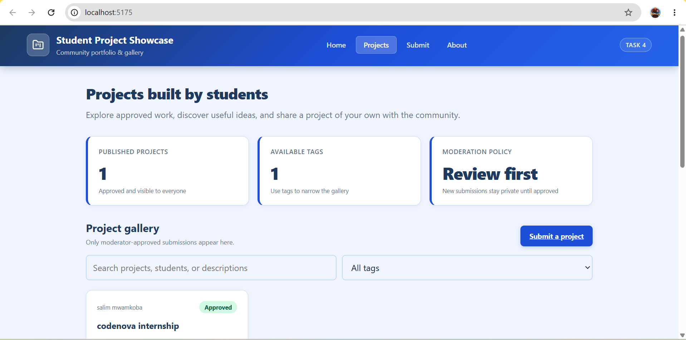
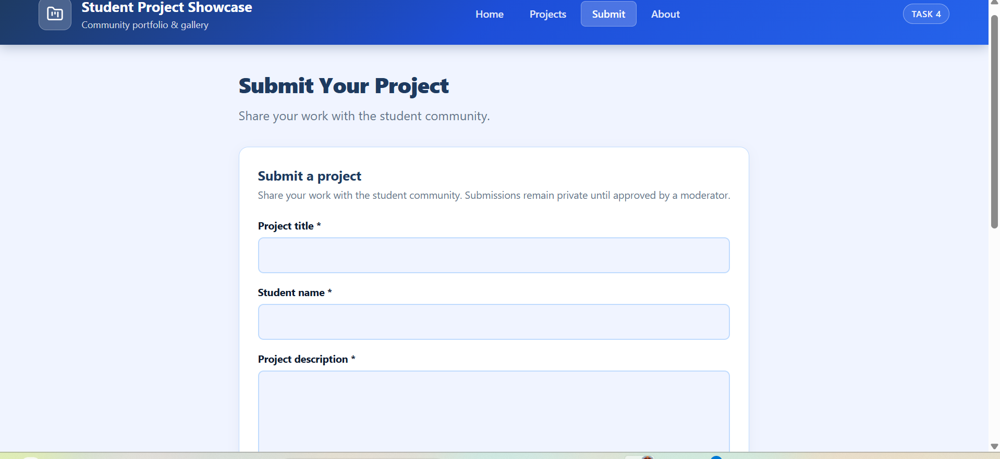
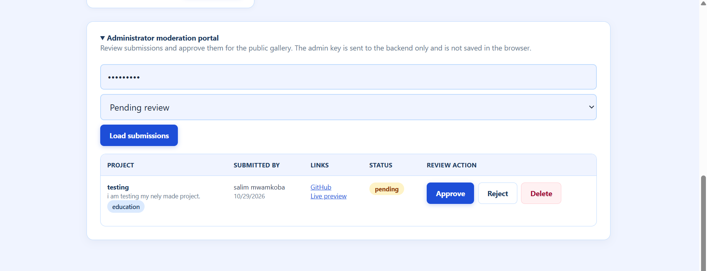
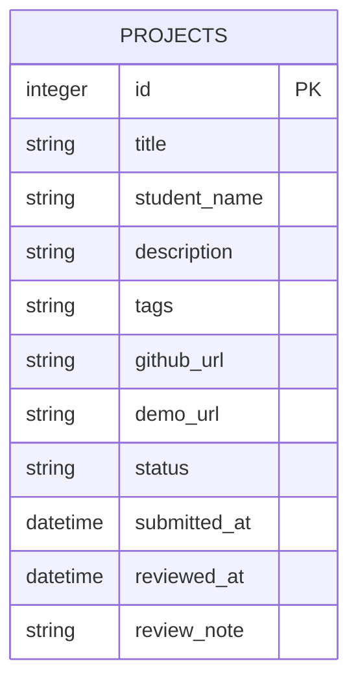

# Student Project Showcase (Task 4)

> **CodeNova Full Stack Internship - Batch 01**
> Remote / Online | 4 Weeks Self-Paced | Deadline: 06 November 2026

A community gallery where students submit their projects for review. Approved projects appear on a public searchable showcase. Admins moderate the submission queue through a protected dashboard — approving, rejecting, or deleting entries.

---

## Screenshots







---

## Tech Stack

| Layer | Technology |
| :--- | :--- |
| **Frontend** | React 19 + Vite, Inter font |
| **Backend** | Node.js + Express (ESM) |
| **Database** | SQLite via `better-sqlite3` |
| **Styling** | Custom CSS — navy/blue theme, responsive layout |
| **Auth** | Admin key via `x-admin-key` request header |

---

## Features

- Public gallery with keyword search and tag filtering — only approved projects shown
- Project submission form with full server-side validation (GitHub URL format, live demo URL, tag limits)
- Status lifecycle: `pending` → `approved` / `rejected`
- Admin moderation queue: review pending submissions with optional review notes
- Admin can approve, reject, or permanently delete any submission
- Three approved sample projects seeded automatically on first run

---

## Project Structure

```text
task-4-student-project-showcase/
├── backend/
│   ├── src/
│   │   ├── db.js              # SQLite setup, schema, sample seed
│   │   ├── server.js          # Express entry point
│   │   ├── validation.js      # Submission field validation
│   │   └── routes/
│   │       ├── projects.js
│   │       └── admin.js
│   ├── data/.gitkeep
│   └── .env.example
├── frontend/
│   ├── src/
│   │   ├── components/
│   │   │   ├── AdminPanel.jsx
│   │   │   ├── LoadingState.jsx
│   │   │   ├── Notice.jsx
│   │   │   └── ProjectForm.jsx
│   │   ├── App.jsx
│   │   ├── api.js
│   │   └── styles.css
│   ├── .env
│   └── vite.config.js
├── screenshort1.png
├── screenshort2.png
├── screenshort3.png
└── README.md
```

---

## Database Model



---

## API Reference

**Base URL:** `http://localhost:5005/api`

| Method | Route | Description |
| :--- | :--- | :--- |
| `GET` | `/health` | Health check |
| `GET` | `/projects?q=&tag=` | Public approved gallery — keyword and tag filters |
| `POST` | `/projects` | Submit a new project (saved as `pending`) |
| `GET` | `/admin/projects?status=pending` | Admin: moderation queue (`pending`, `approved`, `rejected`, or `all`) |
| `PATCH` | `/admin/projects/:id/review` | Admin: update status + optional review note |
| `DELETE` | `/admin/projects/:id` | Admin: permanently delete a submission |

**Admin routes** require the `x-admin-key` header matching the backend `ADMIN_KEY` env var.

### Submission POST body

```json
{
  "title": "My Portfolio Site",
  "student_name": "Jane Doe",
  "description": "A personal portfolio built with React and deployed on Netlify...",
  "tags": ["React", "Vite", "Netlify"],
  "github_url": "https://github.com/janedoe/portfolio",
  "demo_url": "https://janedoe.netlify.app"
}
```

**Validation rules:** title 4–100 chars; student name 2–100 chars; description 30–1500 chars; GitHub URL must match `github.com/` format; demo URL must be a valid HTTP/HTTPS URL; 1–8 tags each max 30 chars.

---

## Local Setup

### Prerequisites
- Node.js v20+
- npm

### Backend (port 5005)

```bash
cd task-4-student-project-showcase/backend
npm install
cp .env.example .env
# Set a strong ADMIN_KEY in .env
npm run dev
# API running at http://localhost:5005
```

### Frontend (port 5175)

```bash
cd task-4-student-project-showcase/frontend
npm install
npm run dev
# Open http://localhost:5175
```

### From the repo root

```bash
npm run backend:task4   # Start backend  → http://localhost:5005
npm run frontend:task4  # Start frontend → http://localhost:5175
```

---

## Deployment

| Target | Platform | Config |
| :--- | :--- | :--- |
| Frontend | Netlify | Base: `frontend`, Build: `npm run build`, Publish: `dist`, Env: `VITE_API_URL` |
| Backend | Render | Root: `backend`, Start: `npm start`, Env: `PORT`, `ADMIN_KEY`, `DATABASE_PATH`, `FRONTEND_ORIGIN` |

---

## Security Notes

- Admin routes are gated by `x-admin-key` — set a long private key in `.env`, never commit it
- The public gallery endpoint filters at the database level to `status = 'approved'` — pending and rejected submissions are never exposed
- SQLite works for single-instance deployments; use a managed database for multi-instance or ephemeral hosts
